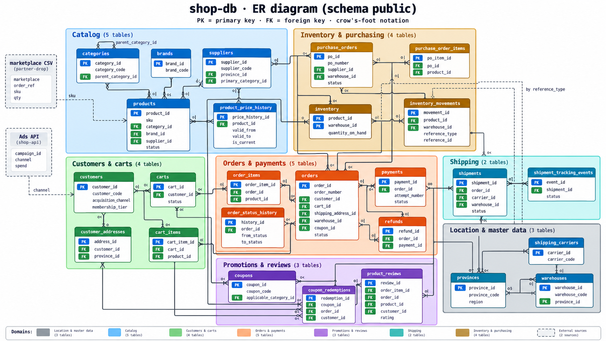

# Data dictionary · ระบบต้นทางของร้านค้าออนไลน์

เอกสารนี้อธิบายข้อมูลทุกชุดที่ทีม DE ดึงได้จากระบบต้นทาง (วิธีเปิดใช้งานและการเชื่อมต่อ ดูใน [README](../README.md))

| แหล่งข้อมูล | รูปแบบ | หัวข้อ |
|---|---|---|
| `shop-db` | PostgreSQL database `shop` schema `public` (26 ตาราง) | [1–8](#1-ภาพรวม-shop-db) |
| `partner-drop` | ไฟล์ CSV รายวันจาก marketplace | [9](#9-partner-drop--marketplace_orders_yyyy-mm-ddcsv) |
| `shop-api` | REST API ค่าโฆษณารายวัน | [10](#10-shop-api--ad-spend) |



> ภาพ ER diagram แสดงเฉพาะคอลัมน์ที่เป็นคีย์ คอลัมน์ทั้งหมดอยู่ในตารางด้านล่าง

---

## 1. ภาพรวม `shop-db`

### ข้อตกลงทั่วไป

- **เวลา** ทุกคอลัมน์ `timestamp` เป็นเวลาไทย (UTC+7) แบบ **ไม่มี timezone** ละเอียดถึงวินาที
- **เงิน** เป็นเงินบาท ชนิด `numeric(12,2)` (ยกเว้น `purchase_orders.total_cost` เป็น `numeric(14,2)`)
- **ไม่มี constraint ใน database**: ไม่มี primary key / foreign key / unique ประกาศไว้
  คีย์และความสัมพันธ์ในเอกสารนี้คือความหมายทางธุรกิจที่ทีม SWE ยืนยัน ฝั่ง DE ควรตรวจเองก่อนนำไปใช้
- **ข้อมูลเดินตามเวลาจริง**: มีแถวใหม่เข้ามาตลอด และบางตารางแถวเดิมถูกแก้ไข (ดูคอลัมน์ "แถวเดิมถูกแก้" ในข้อ 1.1)
  ตารางที่ถูกแก้ส่วนใหญ่มี `updated_at` บอกเวลาที่แก้ล่าสุด
- **ไม่มีการลบแถว** ถ้าเลิกใช้จะใช้สถานะแทน เช่น `status`, `is_active`
- **ข้อมูลส่วนบุคคล (PDPA)** อยู่ที่ `customers` (ชื่อ, email, เบอร์โทร, วันเกิด) และ `customer_addresses` (ชื่อผู้รับ, เบอร์โทร, ที่อยู่)
- `NULL` หมายถึง "ยังไม่เกิด / ไม่มี" เช่น `orders.shipped_at` เป็น `NULL` = ยังไม่ส่งของ

### 1.1 รายการตาราง

จำนวนแถวโดยประมาณ ณ วันที่ 29 ต.ค. 2026 (ตัวเลขเพิ่มขึ้นทุกวัน)

| กลุ่ม | ตาราง | 1 แถว = | จำนวนแถว | แถวเดิมถูกแก้ | คอลัมน์เวลา |
|---|---|---|---:|:---:|---|
| สถานที่ / master | `provinces` | 1 จังหวัด | 77 | – | – |
| | `warehouses` | 1 คลังสินค้า | 4 | – | `created_at` |
| | `shipping_carriers` | 1 บริษัทขนส่ง | 5 | – | `created_at` |
| สินค้า | `categories` | 1 หมวดสินค้า | 41 | – | `created_at` |
| | `brands` | 1 แบรนด์ | 77 | – | `created_at` |
| | `suppliers` | 1 ผู้ขายส่ง | 25 | – | `created_at`, `updated_at` |
| | `products` | 1 สินค้า (SKU) | 2,010 | ✔ | `created_at`, `updated_at` |
| | `product_price_history` | 1 ช่วงราคาของสินค้า | 5,172 | – | `valid_from`, `valid_to` |
| ลูกค้า / ตะกร้า | `customers` | 1 ลูกค้า | 52,740 | ✔ | `created_at`, `updated_at` |
| | `customer_addresses` | 1 ที่อยู่ของลูกค้า | 57,351 | ✔ | `created_at`, `updated_at` |
| | `carts` | 1 ตะกร้า | 736,906 | ✔ | `created_at`, `updated_at` |
| | `cart_items` | 1 สินค้าในตะกร้า | 1,396,250 | – | `added_at` |
| คำสั่งซื้อ / ชำระเงิน | `orders` | 1 คำสั่งซื้อ | 257,830 | ✔ | `created_at`, `updated_at` |
| | `order_items` | 1 บรรทัดสินค้าใน order | 437,648 | – | – (ใช้เวลาของ `orders`) |
| | `order_status_history` | 1 ครั้งที่ order เปลี่ยนสถานะ | 1,420,282 | – | `changed_at` |
| | `payments` | 1 ครั้งที่พยายามจ่ายเงิน | 263,398 | ✔ | `created_at`, `updated_at` |
| | `refunds` | 1 การคืนเงิน | 14,363 | ✔ | `created_at`, `updated_at` |
| โปรโมชัน / รีวิว | `coupons` | 1 คูปอง | 145 | – | `created_at`, `updated_at` |
| | `coupon_redemptions` | 1 ครั้งที่ใช้คูปอง | 24,235 | ✔ | `redeemed_at`, `updated_at` |
| | `product_reviews` | 1 รีวิว | 113,051 | – | `created_at` |
| ขนส่ง | `shipments` | 1 พัสดุ | 236,654 | ✔ | `created_at`, `updated_at` |
| | `shipment_tracking_events` | 1 เหตุการณ์ tracking | 1,206,294 | – | `event_at` |
| คลังสินค้า / จัดซื้อ | `inventory` | 1 สินค้า × 1 คลัง (ยอดคงเหลือปัจจุบัน) | 4,977 | ✔ | `updated_at` |
| | `inventory_movements` | 1 ครั้งที่ของเข้า/ออกคลัง | 551,688 | – | `created_at` |
| | `purchase_orders` | 1 ใบสั่งซื้อถึง supplier | 15,350 | ✔ | `created_at`, `updated_at` |
| | `purchase_order_items` | 1 สินค้าในใบสั่งซื้อ | 64,612 | ✔ | – |

### 1.2 ความสัมพันธ์หลัก

ใช้เครื่องหมาย `A 1 ── N B` = 1 แถวของ A มีได้หลายแถวใน B · `0..1` = มีได้ไม่เกิน 1 แถว

| จาก (parent) | ไป (child) | เชื่อมด้วย | จำนวน |
|---|---|---|---|
| `provinces` | `warehouses`, `suppliers`, `customer_addresses` | `province_id` | 1 ── N |
| `categories` | `categories` | `category_id` = `parent_category_id` | 1 ── N (หมวดหลัก → หมวดย่อย) |
| `categories` | `products` | `category_id` | 1 ── N |
| `categories` | `suppliers` | `category_id` = `primary_category_id` | 1 ── N |
| `categories` | `coupons` | `category_id` = `applicable_category_id` | 1 ── N |
| `brands` | `products` | `brand_id` | 1 ── N |
| `suppliers` | `products`, `purchase_orders` | `supplier_id` | 1 ── N |
| `products` | `product_price_history`, `cart_items`, `order_items`, `inventory`, `inventory_movements`, `purchase_order_items` | `product_id` | 1 ── N |
| `customers` | `customer_addresses`, `carts`, `orders`, `coupon_redemptions`, `product_reviews` | `customer_id` | 1 ── N |
| `carts` | `cart_items` | `cart_id` | 1 ── N |
| `carts` | `orders` | `cart_id` | 1 ── 0..1 (ตะกร้าที่ `converted` กลายเป็น order 1 ใบ) |
| `customer_addresses` | `orders` | `address_id` = `shipping_address_id` | 1 ── N |
| `warehouses` | `orders`, `shipments`, `inventory`, `inventory_movements`, `purchase_orders` | `warehouse_id` | 1 ── N |
| `coupons` | `orders`, `coupon_redemptions` | `coupon_id` | 1 ── N |
| `orders` | `order_items`, `order_status_history`, `payments` | `order_id` | 1 ── N |
| `orders` | `shipments`, `refunds`, `coupon_redemptions` | `order_id` | 1 ── 0..1 |
| `payments` | `refunds` | `payment_id` | 1 ── 0..1 |
| `order_items` | `product_reviews` | `order_item_id` | 1 ── 0..1 |
| `shipping_carriers` | `shipments` | `carrier_id` | 1 ── N |
| `shipments` | `shipment_tracking_events` | `shipment_id` | 1 ── N |
| `purchase_orders` | `purchase_order_items` | `po_id` | 1 ── N |
| `orders` / `purchase_orders` | `inventory_movements` | `reference_id` (ดูตาม `reference_type`) | 1 ── N |

ความสัมพันธ์ข้ามแหล่งข้อมูล
- ไฟล์ marketplace `sku` = `products.sku`
- Ads API `channel` = `customers.acquisition_channel` (ลูกค้าที่มาจาก `organic` และ `referral` ไม่มีค่าโฆษณา)

---

## 2. สถานที่ / master data

### `provinces` · จังหวัด

| คอลัมน์ | ชนิด | คีย์ | คำอธิบาย |
|---|---|---|---|
| `province_id` | smallint | PK | รหัสจังหวัดตามกรมการปกครอง เช่น `10` = กรุงเทพฯ |
| `province_code` | varchar(5) | | รหัส ISO 3166-2 เช่น `TH-10` |
| `name_th` | varchar(100) | | ชื่อภาษาไทย |
| `name_en` | varchar(100) | | ชื่อภาษาอังกฤษ |
| `region` | varchar(20) | | ภาค: `Central`, `North`, `Northeast`, `East`, `West`, `South` |
| `postal_prefix` | char(2) | | 2 หลักแรกของรหัสไปรษณีย์ในจังหวัด |

### `warehouses` · คลังสินค้า

| คอลัมน์ | ชนิด | คีย์ | คำอธิบาย |
|---|---|---|---|
| `warehouse_id` | smallint | PK | |
| `warehouse_code` | varchar(12) | | เช่น `WH-BKK-01` (บางนา), `WH-CNX-01` (เชียงใหม่), `WH-KKC-01` (ขอนแก่น), `WH-HDY-01` (หาดใหญ่) |
| `warehouse_name` | varchar(200) | | ชื่อคลัง |
| `province_id` | smallint | FK → `provinces` | จังหวัดที่ตั้งคลัง |
| `address` | varchar(300) | | ที่อยู่คลัง |
| `is_active` | boolean | | ยังเปิดใช้งาน |
| `created_at` | timestamp | | |

### `shipping_carriers` · บริษัทขนส่ง

| คอลัมน์ | ชนิด | คีย์ | คำอธิบาย |
|---|---|---|---|
| `carrier_id` | smallint | PK | |
| `carrier_code` | varchar(5) | | `THP` ไปรษณีย์ไทย, `KEX` KEX Express, `FLS` Flash Express, `JNT` J&T Express, `NJV` Ninja Van |
| `name_th` | varchar(100) | | |
| `name_en` | varchar(100) | | |
| `is_active` | boolean | | |
| `created_at` | timestamp | | |

---

## 3. สินค้า

### `categories` · หมวดสินค้า (2 ระดับ)

| คอลัมน์ | ชนิด | คีย์ | คำอธิบาย |
|---|---|---|---|
| `category_id` | smallint | PK | |
| `category_code` | varchar(10) | | เช่น `ELE` อิเล็กทรอนิกส์, `FAS` แฟชั่น |
| `parent_category_id` | smallint | FK → `categories` | หมวดแม่ · `NULL` = หมวดหลัก (10 หมวด) ที่เหลือเป็นหมวดย่อย |
| `name_th` | varchar(100) | | |
| `name_en` | varchar(100) | | |
| `created_at` | timestamp | | |

### `brands` · แบรนด์

| คอลัมน์ | ชนิด | คีย์ | คำอธิบาย |
|---|---|---|---|
| `brand_id` | smallint | PK | |
| `brand_code` | char(3) | | เช่น `SAM`, `APL` |
| `brand_name` | varchar(100) | | |
| `country_code` | char(2) | | ประเทศต้นทางของแบรนด์ (ISO 3166-1 เช่น `TH`, `US`, `JP`) |
| `created_at` | timestamp | | |

### `suppliers` · ผู้ขายส่ง

| คอลัมน์ | ชนิด | คีย์ | คำอธิบาย |
|---|---|---|---|
| `supplier_id` | integer | PK | |
| `supplier_code` | varchar(10) | | เช่น `SUP-0001` |
| `supplier_name` | varchar(200) | | ชื่อบริษัท |
| `tax_id` | char(13) | | เลขประจำตัวผู้เสียภาษี |
| `contact_name` | varchar(200) | | ผู้ติดต่อ |
| `phone` | varchar(20) | | |
| `email` | varchar(200) | | |
| `province_id` | smallint | FK → `provinces` | ที่ตั้งบริษัท |
| `primary_category_id` | smallint | FK → `categories` | หมวดสินค้าหลักที่ส่งให้ร้าน |
| `lead_time_days` | smallint | | จำนวนวันตั้งแต่สั่งจนของถึงคลังโดยปกติ |
| `payment_term_days` | smallint | | เครดิตเทอม (วัน) |
| `is_active` | boolean | | |
| `created_at` / `updated_at` | timestamp | | |

### `products` · สินค้า

| คอลัมน์ | ชนิด | คีย์ | คำอธิบาย |
|---|---|---|---|
| `product_id` | integer | PK | |
| `sku` | varchar(20) | unique | รหัสสินค้า เช่น `BED-LOT-00001` ใช้จับคู่กับไฟล์ marketplace |
| `product_name` | varchar(255) | | |
| `category_id` | smallint | FK → `categories` | |
| `brand_id` | smallint | FK → `brands` | |
| `supplier_id` | integer | FK → `suppliers` | |
| `unit_price` | numeric(12,2) | | ราคาขาย **ปัจจุบัน** (เท่ากับแถว `is_current` ใน `product_price_history`) |
| `cost_price` | numeric(12,2) | | ต้นทุน **ปัจจุบัน** |
| `weight_grams` | integer | | น้ำหนัก (กรัม) |
| `status` | varchar(15) | | `active` ขายอยู่ · `discontinued` เลิกขาย · `draft` ยังไม่วางขาย (กำหนดวางขายใน `launched_at`) |
| `launched_at` | timestamp | | วันเริ่มวางขาย (สินค้า `draft` เป็นวันในอนาคต) |
| `discontinued_at` | timestamp | | วันเลิกขาย |
| `created_at` / `updated_at` | timestamp | | |

### `product_price_history` · ประวัติราคา (SCD Type 2)

1 สินค้ามีได้หลายแถว แต่ละแถวคือช่วงเวลาที่ใช้ราคานั้น ราคา ณ เวลา `t` คือแถวที่
`valid_from <= t AND (valid_to IS NULL OR valid_to > t)`

| คอลัมน์ | ชนิด | คีย์ | คำอธิบาย |
|---|---|---|---|
| `price_history_id` | bigint | PK | |
| `product_id` | integer | FK → `products` | |
| `unit_price` | numeric(12,2) | | ราคาขายในช่วงนี้ |
| `cost_price` | numeric(12,2) | | ต้นทุนในช่วงนี้ |
| `change_reason` | varchar(20) | | `launch` ราคาแรก · `price_increase` ขึ้นราคา · `price_decrease` ลดราคา |
| `valid_from` | timestamp | | เริ่มใช้ราคานี้ |
| `valid_to` | timestamp | | เลิกใช้ (= `valid_from` ของแถวถัดไป) · `NULL` = ยังใช้อยู่ |
| `is_current` | boolean | | `true` = ราคาปัจจุบัน (1 แถวต่อสินค้า) |

---

## 4. ลูกค้า / ตะกร้า

### `customers` · ลูกค้า

| คอลัมน์ | ชนิด | คีย์ | คำอธิบาย |
|---|---|---|---|
| `customer_id` | bigint | PK | |
| `customer_code` | varchar(12) | | เช่น `CUS-0000001` |
| `email` | varchar(255) | | PDPA |
| `phone` | varchar(20) | | PDPA |
| `first_name` / `last_name` | varchar(100) | | PDPA (ภาษาไทย) |
| `gender` | char(1) | | `F` หญิง · `M` ชาย · `U` ไม่ระบุ |
| `birth_date` | date | | PDPA |
| `membership_tier` | varchar(10) | | `bronze` → `silver` → `gold` → `platinum` |
| `status` | varchar(10) | | `active` · `inactive` · `banned` |
| `acquisition_channel` | varchar(20) | | ช่องทางที่ลูกค้ารู้จักร้าน: `organic`, `referral`, `google_ads`, `facebook_ads`, `tiktok`, `line_oa` (ตรงกับ `channel` ใน Ads API) |
| `marketing_opt_in` | boolean | | ยินยอมรับข่าวสารการตลาด |
| `email_verified_at` | timestamp | | เวลาที่ยืนยัน email · `NULL` = ยังไม่ยืนยัน |
| `last_login_at` | timestamp | | เข้าสู่ระบบล่าสุด |
| `registered_at` | timestamp | | วันสมัครสมาชิก |
| `created_at` / `updated_at` | timestamp | | |

### `customer_addresses` · ที่อยู่จัดส่งของลูกค้า

| คอลัมน์ | ชนิด | คีย์ | คำอธิบาย |
|---|---|---|---|
| `address_id` | bigint | PK | |
| `customer_id` | bigint | FK → `customers` | |
| `address_label` | varchar(10) | | `home` · `work` · `other` |
| `recipient_name` | varchar(200) | | ชื่อผู้รับ (PDPA) |
| `phone` | varchar(20) | | เบอร์ผู้รับ (PDPA) |
| `address_line1` / `address_line2` | varchar(300) | | บ้านเลขที่ ถนน ซอย (PDPA) |
| `district` | varchar(100) | | เขต / อำเภอ |
| `province_id` | smallint | FK → `provinces` | |
| `postal_code` | char(5) | | |
| `is_default` | boolean | | ที่อยู่หลักของลูกค้า |
| `created_at` / `updated_at` | timestamp | | |

### `carts` · ตะกร้าสินค้า

| คอลัมน์ | ชนิด | คีย์ | คำอธิบาย |
|---|---|---|---|
| `cart_id` | bigint | PK | |
| `customer_id` | bigint | FK → `customers` | |
| `status` | varchar(10) | | `active` ยังเลือกของอยู่ · `converted` กลายเป็น order แล้ว · `abandoned` ทิ้งตะกร้า |
| `created_at` / `updated_at` | timestamp | | |
| `converted_at` | timestamp | | เวลาที่กดสั่งซื้อ (= `orders.ordered_at`) |
| `abandoned_at` | timestamp | | เวลาที่ถือว่าทิ้งตะกร้า |

### `cart_items` · สินค้าในตะกร้า

| คอลัมน์ | ชนิด | คีย์ | คำอธิบาย |
|---|---|---|---|
| `cart_item_id` | bigint | PK | |
| `cart_id` | bigint | FK → `carts` | |
| `product_id` | integer | FK → `products` | |
| `quantity` | integer | | จำนวนชิ้น |
| `unit_price` | numeric(12,2) | | ราคาต่อชิ้นตอนหยิบใส่ตะกร้า |
| `added_at` | timestamp | | |

---

## 5. คำสั่งซื้อ / ชำระเงิน

### `orders` · คำสั่งซื้อ (ช่องทางของร้านเอง: app และ web)

| คอลัมน์ | ชนิด | คีย์ | คำอธิบาย |
|---|---|---|---|
| `order_id` | bigint | PK | |
| `order_number` | varchar(20) | | เลข order ที่ลูกค้าเห็น `ORD-YYMMDD-NNNNNN` |
| `customer_id` | bigint | FK → `customers` | |
| `cart_id` | bigint | FK → `carts` | ตะกร้าที่กลายเป็น order นี้ |
| `shipping_address_id` | bigint | FK → `customer_addresses` | ที่อยู่จัดส่ง |
| `warehouse_id` | smallint | FK → `warehouses` | คลังที่ส่งของ |
| `sales_channel` | varchar(10) | | `android` · `ios` · `web` |
| `status` | varchar(20) | | สถานะปัจจุบัน ดูลำดับสถานะด้านล่าง |
| `payment_method` | varchar(20) | | `credit_card` · `promptpay` · `mobile_banking` · `true_money` · `cod` (เก็บเงินปลายทาง) |
| `coupon_id` | integer | FK → `coupons` | `NULL` = ไม่ใช้คูปอง |
| `subtotal_amount` | numeric(12,2) | | ยอดค่าสินค้า |
| `discount_amount` | numeric(12,2) | | ส่วนลดระดับ order |
| `shipping_fee` | numeric(12,2) | | ค่าส่งที่เก็บจากลูกค้า |
| `shipping_discount` | numeric(12,2) | | ส่วนลดค่าส่ง |
| `total_amount` | numeric(12,2) | | ยอดที่ลูกค้าจ่าย = `subtotal_amount - discount_amount + shipping_fee - shipping_discount` |
| `ordered_at` | timestamp | | เวลาที่สั่งซื้อ |
| `paid_at` | timestamp | | เวลาที่จ่ายเงินสำเร็จ (COD = ตอนส่งของถึง) |
| `shipped_at` | timestamp | | ส่งมอบให้ขนส่ง |
| `delivered_at` | timestamp | | ส่งถึงลูกค้า |
| `completed_at` | timestamp | | order จบสมบูรณ์ |
| `cancelled_at` | timestamp | | |
| `cancelled_by` | varchar(10) | | `system` · `customer` · `admin` |
| `cancel_reason` | varchar(50) | | `payment_timeout`, `changed_mind`, `found_better_price`, `ordered_by_mistake`, `want_to_change_address`, `delivery_too_slow`, `out_of_stock` |
| `return_reason` | varchar(50) | | `not_as_described`, `defective`, `wrong_size`, `changed_mind` |
| `created_at` / `updated_at` | timestamp | | `updated_at` เปลี่ยนทุกครั้งที่สถานะหรือข้อมูลใน order เปลี่ยน |

**ลำดับสถานะของ order**

```
pending_payment ─► confirmed ─► processing ─► shipped ─► delivered ─► completed
      │                │             │            │            │
      │                └──────┬──────┘            │            └─► return_requested ─► returned
      ▼                       ▼                   ▼
  cancelled               cancelled         delivery_failed ─► returned
 (ไม่จ่ายเงินทันเวลา)     (ลูกค้า / admin ยกเลิก)
```

- order ที่จ่ายแบบ `cod` เริ่มที่ `confirmed` เลย (ไม่ผ่าน `pending_payment`)
- ทุกครั้งที่เปลี่ยนสถานะ จะมี 1 แถวใน `order_status_history`

### `order_items` · สินค้าใน order

| คอลัมน์ | ชนิด | คีย์ | คำอธิบาย |
|---|---|---|---|
| `order_item_id` | bigint | PK | |
| `order_id` | bigint | FK → `orders` | |
| `line_number` | smallint | | ลำดับบรรทัดใน order (เริ่มที่ 1) |
| `product_id` | integer | FK → `products` | |
| `quantity` | integer | | จำนวนชิ้น |
| `unit_price` | numeric(12,2) | | ราคาต่อชิ้น ณ เวลาที่สั่ง |
| `discount_amount` | numeric(12,2) | | ส่วนลดของบรรทัดนี้ |
| `line_total` | numeric(12,2) | | `quantity × unit_price - discount_amount` |

### `order_status_history` · ประวัติการเปลี่ยนสถานะ order

| คอลัมน์ | ชนิด | คีย์ | คำอธิบาย |
|---|---|---|---|
| `history_id` | bigint | PK | |
| `order_id` | bigint | FK → `orders` | |
| `from_status` | varchar(20) | | สถานะก่อนเปลี่ยน · `NULL` = แถวแรกตอนสร้าง order |
| `to_status` | varchar(20) | | สถานะใหม่ |
| `changed_by` | varchar(10) | | `system` · `customer` · `admin` |
| `note` | varchar(200) | | หมายเหตุ เช่น `payment received`, `warehouse picking`, เหตุผลที่ยกเลิก/คืนของ |
| `changed_at` | timestamp | | |

### `payments` · การชำระเงิน

1 order มีได้หลายแถว (ลองจ่ายใหม่เมื่อครั้งก่อนไม่สำเร็จ สูงสุด 3 ครั้ง)

| คอลัมน์ | ชนิด | คีย์ | คำอธิบาย |
|---|---|---|---|
| `payment_id` | bigint | PK | |
| `payment_code` | varchar(20) | | เช่น `PAY-000000001` |
| `order_id` | bigint | FK → `orders` | |
| `attempt_number` | smallint | | ครั้งที่ของการจ่าย (1, 2, 3) |
| `payment_method` | varchar(20) | | เหมือน `orders.payment_method` |
| `provider` | varchar(50) | | `VISA`, `Mastercard`, `JCB`, `PromptPay QR`, `TrueMoney Wallet`, `K PLUS`, `SCB EASY`, `KMA`, `Krungthai NEXT`, `Bualuang mBanking`, `Cash on Delivery` |
| `amount` | numeric(12,2) | | ยอดเงิน |
| `status` | varchar(10) | | `pending` รอจ่าย · `success` สำเร็จ · `failed` ไม่ผ่าน · `expired` หมดเวลา · `cancelled` ยกเลิก · `refunded` คืนเงินแล้ว |
| `gateway_txn_id` | varchar(40) | | เลขอ้างอิงจาก payment gateway |
| `failure_reason` | varchar(50) | | เมื่อ `failed` / `expired`: `card_declined`, `insufficient_funds`, `expired_card`, `3ds_authentication_failed`, `timeout`, `bank_system_error`, `user_cancelled` |
| `created_at` | timestamp | | เริ่มทำรายการ |
| `paid_at` | timestamp | | จ่ายสำเร็จ (มีค่าเฉพาะ `success` และ `refunded`) |
| `updated_at` | timestamp | | |

### `refunds` · การคืนเงิน

| คอลัมน์ | ชนิด | คีย์ | คำอธิบาย |
|---|---|---|---|
| `refund_id` | bigint | PK | |
| `refund_code` | varchar(20) | | เช่น `RFD-00000001` |
| `order_id` | bigint | FK → `orders` | |
| `payment_id` | bigint | FK → `payments` | รายการจ่ายเงินที่ถูกคืน |
| `amount` | numeric(12,2) | | ยอดคืน |
| `refund_method` | varchar(20) | | `original_payment` คืนช่องทางเดิม · `bank_transfer` โอนเข้าบัญชี |
| `reason` | varchar(50) | | `order_cancelled`, `delivery_failed`, `not_as_described`, `defective`, `wrong_size`, `changed_mind` |
| `status` | varchar(10) | | `pending` · `completed` |
| `requested_at` | timestamp | | ขอคืนเงิน |
| `processed_at` | timestamp | | คืนเงินเสร็จ |
| `created_at` / `updated_at` | timestamp | | |

---

## 6. โปรโมชัน / รีวิว

### `coupons` · คูปองส่วนลด

| คอลัมน์ | ชนิด | คีย์ | คำอธิบาย |
|---|---|---|---|
| `coupon_id` | integer | PK | |
| `coupon_code` | varchar(30) | | โค้ดที่ลูกค้ากรอก เช่น `WELCOME100` |
| `campaign_name` | varchar(100) | | แคมเปญ เช่น `1.1 Mega Sale` |
| `description` | varchar(300) | | เงื่อนไข (ภาษาไทย) |
| `discount_type` | varchar(15) | | `fixed_amount` ลดเป็นบาท · `percentage` ลดเป็น % · `free_shipping` ลดค่าส่ง |
| `discount_value` | numeric(12,2) | | จำนวนบาท หรือ % ตาม `discount_type` |
| `max_discount_amount` | numeric(12,2) | | ลดสูงสุด (บาท) · `NULL` = ไม่จำกัด |
| `min_order_amount` | numeric(12,2) | | ยอดสั่งซื้อขั้นต่ำ |
| `applicable_category_id` | smallint | FK → `categories` | ใช้ได้เฉพาะหมวดนี้ · `NULL` = ทุกหมวด |
| `usage_limit_total` | integer | | จำนวนครั้งที่ใช้ได้ทั้งหมด · `NULL` = ไม่จำกัด |
| `usage_limit_per_customer` | integer | | จำนวนครั้งต่อลูกค้า 1 คน |
| `first_order_only` | boolean | | ใช้ได้เฉพาะ order แรกของลูกค้า |
| `valid_from` / `valid_to` | timestamp | | ช่วงเวลาที่ใช้คูปองได้ · `valid_to` = `NULL` คือไม่มีวันหมดอายุ |
| `is_active` | boolean | | |
| `created_at` / `updated_at` | timestamp | | |

### `coupon_redemptions` · การใช้คูปอง

| คอลัมน์ | ชนิด | คีย์ | คำอธิบาย |
|---|---|---|---|
| `redemption_id` | bigint | PK | |
| `coupon_id` | integer | FK → `coupons` | |
| `order_id` | bigint | FK → `orders` | 1 order ใช้คูปองได้ 1 ใบ |
| `customer_id` | bigint | FK → `customers` | |
| `discount_amount` | numeric(12,2) | | ส่วนลดที่ได้จริง (บาท) |
| `status` | varchar(10) | | `applied` ใช้แล้ว · `reversed` ถูกยกเลิกการใช้ (ดู `reversed_at`) |
| `redeemed_at` | timestamp | | |
| `reversed_at` | timestamp | | |
| `updated_at` | timestamp | | |

### `product_reviews` · รีวิวสินค้า

| คอลัมน์ | ชนิด | คีย์ | คำอธิบาย |
|---|---|---|---|
| `review_id` | bigint | PK | |
| `order_item_id` | bigint | FK → `order_items` | รีวิวได้ 1 ครั้งต่อ 1 บรรทัดสินค้า |
| `order_id` | bigint | FK → `orders` | |
| `product_id` | integer | FK → `products` | |
| `customer_id` | bigint | FK → `customers` | |
| `rating` | smallint | | คะแนน 1–5 |
| `review_text` | varchar(500) | | ข้อความรีวิว (ภาษาไทย) |
| `created_at` | timestamp | | |

---

## 7. ขนส่ง

### `shipments` · พัสดุ

| คอลัมน์ | ชนิด | คีย์ | คำอธิบาย |
|---|---|---|---|
| `shipment_id` | bigint | PK | |
| `order_id` | bigint | FK → `orders` | 1 order มีพัสดุ 1 ชิ้น |
| `carrier_id` | smallint | FK → `shipping_carriers` | |
| `warehouse_id` | smallint | FK → `warehouses` | คลังที่ส่งออก |
| `tracking_number` | varchar(30) | | เลขพัสดุของบริษัทขนส่ง |
| `status` | varchar(20) | | `picked_up` → `in_transit` → `delivered` · กรณีส่งไม่สำเร็จ: `delivery_failed` → `returning` → `returned` |
| `weight_grams` | integer | | น้ำหนักพัสดุ (กรัม) |
| `shipping_cost` | numeric(12,2) | | ค่าขนส่งที่ร้านจ่ายให้บริษัทขนส่ง (คนละตัวกับ `orders.shipping_fee` ที่เก็บจากลูกค้า) |
| `shipped_at` | timestamp | | |
| `estimated_delivery_date` | date | | วันที่คาดว่าจะส่งถึง |
| `delivered_at` | timestamp | | |
| `returned_at` | timestamp | | พัสดุตีกลับถึงคลัง |
| `created_at` / `updated_at` | timestamp | | |

### `shipment_tracking_events` · เหตุการณ์ tracking ของพัสดุ

| คอลัมน์ | ชนิด | คีย์ | คำอธิบาย |
|---|---|---|---|
| `event_id` | bigint | PK | |
| `shipment_id` | bigint | FK → `shipments` | |
| `status` | varchar(20) | | `picked_up`, `in_transit`, `out_for_delivery`, `delivered`, `delivery_failed`, `returning`, `returned` |
| `location` | varchar(200) | | สถานที่ (ภาษาไทย) |
| `description` | varchar(300) | | รายละเอียด (ภาษาไทย) |
| `event_at` | timestamp | | |

---

## 8. คลังสินค้า / จัดซื้อ

### `inventory` · ยอดสินค้าคงคลังปัจจุบัน

| คอลัมน์ | ชนิด | คีย์ | คำอธิบาย |
|---|---|---|---|
| `product_id` | integer | PK, FK → `products` | |
| `warehouse_id` | smallint | PK, FK → `warehouses` | |
| `quantity_on_hand` | integer | | จำนวนที่มีอยู่ตอนนี้ |
| `reorder_point` | integer | | ถ้าต่ำกว่านี้ควรสั่งของเพิ่ม |
| `reorder_quantity` | integer | | จำนวนที่สั่งเพิ่มต่อครั้ง |
| `last_restocked_at` | timestamp | | รับของเข้าล่าสุด |
| `updated_at` | timestamp | | |

### `inventory_movements` · การเคลื่อนไหวของสินค้าในคลัง

| คอลัมน์ | ชนิด | คีย์ | คำอธิบาย |
|---|---|---|---|
| `movement_id` | bigint | PK | |
| `product_id` | integer | FK → `products` | |
| `warehouse_id` | smallint | FK → `warehouses` | |
| `movement_type` | varchar(20) | | `sale` ขายออก (−) · `order_cancel` คืนเข้าคลังเพราะยกเลิก (+) · `customer_return` ลูกค้าคืนของ (+) · `delivery_return` พัสดุตีกลับ (+) · `purchase_receipt` รับของจาก supplier (+) · `adjustment` ปรับยอดจากการนับสต็อก (±) |
| `quantity` | integer | | จำนวน · บวก = เข้าคลัง · ลบ = ออกจากคลัง |
| `balance_after` | integer | | ยอดคงเหลือหลังรายการนี้ |
| `reference_type` | varchar(20) | | `order` · `purchase_order` · `stock_count` |
| `reference_id` | bigint | | `order_id` เมื่อเป็น `order`, `po_id` เมื่อเป็น `purchase_order`, `NULL` เมื่อเป็น `stock_count` |
| `created_at` | timestamp | | |

### `purchase_orders` · ใบสั่งซื้อถึง supplier

| คอลัมน์ | ชนิด | คีย์ | คำอธิบาย |
|---|---|---|---|
| `po_id` | bigint | PK | |
| `po_number` | varchar(20) | | `PO-YYYYMM-NNNNNN` |
| `supplier_id` | integer | FK → `suppliers` | |
| `warehouse_id` | smallint | FK → `warehouses` | คลังที่รับของ |
| `status` | varchar(12) | | `ordered` สั่งแล้วรอของ · `received` รับของแล้ว · `cancelled` |
| `total_cost` | numeric(14,2) | | มูลค่ารวม (บาท) |
| `ordered_at` | timestamp | | |
| `expected_at` | timestamp | | กำหนดของถึง |
| `received_at` | timestamp | | |
| `cancelled_at` | timestamp | | |
| `created_at` / `updated_at` | timestamp | | |

### `purchase_order_items` · สินค้าในใบสั่งซื้อ

| คอลัมน์ | ชนิด | คีย์ | คำอธิบาย |
|---|---|---|---|
| `po_item_id` | bigint | PK | |
| `po_id` | bigint | FK → `purchase_orders` | |
| `product_id` | integer | FK → `products` | |
| `quantity_ordered` | integer | | จำนวนที่สั่ง |
| `quantity_received` | integer | | จำนวนที่รับจริง (เปลี่ยนเมื่อของถึงคลัง) |
| `unit_cost` | numeric(12,2) | | ต้นทุนต่อชิ้น |

---

## 9. `partner-drop` · `marketplace_orders_<YYYY-MM-DD>.csv`

ยอดขายของร้านบน marketplace (Shopee / Lazada / TikTok Shop) ที่ partner ส่งมาเป็นไฟล์ รอบส่งและการตั้งชื่อไฟล์ดูใน README ข้อ 3

- order ในไฟล์นี้ **ไม่อยู่** ในตาราง `orders` ของ `shop-db` (เป็นคนละช่องทางขาย)
- 1 ไฟล์ = order ของวันนั้นทั้งวัน · 1 แถว = 1 สินค้าใน 1 order (order เดียวมีได้หลายแถว)
- UTF-8, คั่นด้วย `,`, แถวแรกเป็นชื่อคอลัมน์
- partner เป็นระบบภายนอก ร้านไม่ได้ตรวจข้อมูลก่อนส่งมา

| คอลัมน์ | รูปแบบ | คำอธิบาย |
|---|---|---|
| `marketplace` | text | `shopee` · `lazada` · `tiktok_shop` |
| `order_ref` | text | เลข order ฝั่ง marketplace |
| `order_datetime` | `YYYY-MM-DD HH:MM:SS` | เวลาที่สั่ง (เวลาไทย) |
| `sku` | text | รหัสสินค้า = `products.sku` |
| `qty` | integer | จำนวนชิ้น |
| `unit_price` | decimal 2 ตำแหน่ง | ราคาต่อชิ้นที่ขายบน marketplace (บาท) |
| `platform_fee` | decimal 2 ตำแหน่ง | ค่าธรรมเนียมที่ marketplace หักจากบรรทัดนี้ (บาท) |
| `status` | text | `completed` · `shipped` · `cancelled` |

---

## 10. `shop-api` · ad spend

ค่าโฆษณาที่ร้านจ่ายต่อวัน แยกตาม campaign · endpoint, การยืนยันตัวตน และเวลาที่รายงานพร้อม ดูใน README ข้อ 4

### `GET /v1/ad-spend` · 1 record = 1 campaign × 1 วัน

| field | ชนิด | คำอธิบาย |
|---|---|---|
| `date` | string `YYYY-MM-DD` | วันที่ของรายงาน |
| `campaign_id` | string | รหัส campaign เช่น `GGL-PMAX` |
| `campaign_name` | string | ชื่อ campaign |
| `channel` | string | `google_ads` · `facebook_ads` · `tiktok` · `line_oa` (= `customers.acquisition_channel`) |
| `impressions` | integer | จำนวนครั้งที่โฆษณาแสดง |
| `clicks` | integer | จำนวนคลิก |
| `spend` | number | ค่าโฆษณา (บาท) |

ข้อมูลอยู่ใน field `data` ของ response ส่วน field อื่นในระดับบนเป็นข้อมูลของการแบ่งหน้า

| field | คำอธิบาย |
|---|---|
| `date` | วันที่ที่ขอ |
| `currency` | สกุลเงินของ `spend` (`THB`) |
| `page` / `page_size` | หน้าปัจจุบัน / จำนวน record ต่อหน้า |
| `total_pages` / `total_records` | จำนวนหน้า / record ทั้งหมดของวันนั้น |
| `data` | รายการ record ของหน้านี้ |

### `GET /v1/campaigns` · รายชื่อ campaign

| field | คำอธิบาย |
|---|---|
| `campaign_id` | รหัส campaign |
| `channel` | ช่องทางโฆษณา |
| `campaign_name` | ชื่อ campaign |
